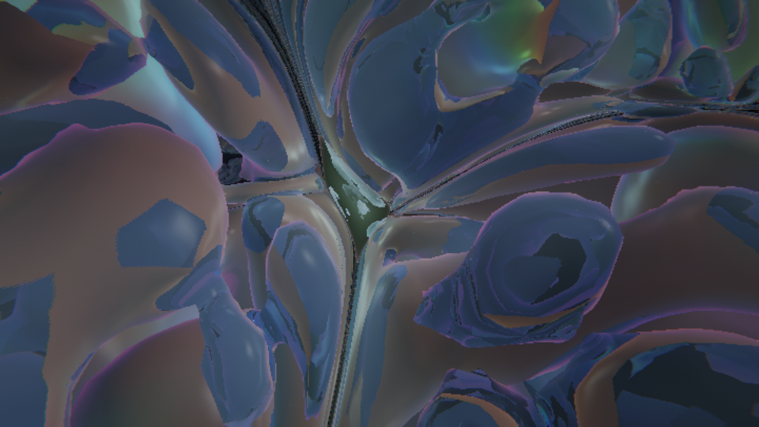

# Crystal Moon V3

The crystal splits the light, the colours write the grain, and now you can see the grain.

[CrystalMoonV2](https://github.com/anttiluode/CrystalMoonv2) made the geometry act on itself: two crystal scales, moonlight that bends through the crystal and writes growth, a moon that is a membrane with another world inside. V3 keeps every law of V2 and changes three things.



*Level 0 in V3: blue glass bodies, the amber lattice inside them, coloured light at the top. Drawn headless with software rendering at 720 × 408.*

One HTML page, WebGL2, no libraries. **Live (once Pages is switched on for this repo):** https://anttiluode.github.io/CrystalMoonV3/

**Controls:** W A S D fly · R / F up and down · Q / E roll · Shift fast · mouse look (click to capture) · click seeds a crystal · M faces the moon · V camera · H hides the panels. Fly into the moon to go a level deeper.

## What was wrong with V2 (measured before changing anything)

I ran V2 for 4 800 steps and looked ([shots/v2-before.png](shots/v2-before.png)). The bodies were smooth pale balloons. Two measurements say why.

- **The body is not a pattern, it is a filled blob.** On the CPU reference, one island at V2's level-0 law with *no* extra light: after 6 000 steps ψ > 0.9 in 96% of the island's core. With the focused light V2 allows (capped at 3) ε goes from 0.26 to 1.08 and the blob saturates at ψ ≈ 1.6 instead of 1.2. The coarse field fills each island evenly; that is what "bodies" are under this law.
- **The fine lattice was there and you could not see it.** In the same run |φ| > 0.3 in about 65% of the body. But the surface you see is the outside of the blob, where the lattice is thin, and V2's glass let 27% of the view through at its default setting.

So V2's most interesting claim, that every body is made of smaller crystal, was true in the numbers and missing from the picture. V3 is built around that.

## What V3 changes

**1. The crystal splits the light.** Moonlight is three colours. They leave the moon as the same photons on the same paths, so empty space stays white (T13: the difference is exactly 0). The lens is stronger for blue than for red:

```
n_c = 1 + κ_c ρ,     κ_c = κ · (1 + D (c − 1)),     c = 0, 1, 2  for red, green, blue        (D = 0.5 at level 0)
```

A crystal ball is then a lens with a different focus for each colour (T14). The light field is three numbers per voxel, 16 384 photons per colour.

**2. The colours do different work.** Brightness still grows the bodies, exactly as in V2. Colour now drives the fine lattice:

```
body     εc = ε_islands + trail + k_fb φ² + k_L ((R+G+B)/3 − 0.25) · island                                  (V2)
lattice  εf = ε_f,sea + (ε_f + k_S · clamp(B − R, ±0.5) · island − ε_f,sea) · smoothstep(−0.2, 0.3, ψ)        (V3)
```

Blue light makes a body fine-grained, red light melts its grain smooth (T15). The grain is part of the density the light bends in, so the loop of V2 (crystal bends light, light writes crystal) now also runs through colour.

**3. You can see the grain.** The ray that refracts into a glass body used to cross it and look for what was behind. Now, on the way through, it can meet a bead of the fine lattice (φ above 0.3) and stop there. The bead is shaded as crystal in the three-coloured light that reached that voxel. If the ray meets no bead it leaves the body and finds what is behind, as in V2. The glass is also clearer: 64% through at the default setting. The lattice is drawn in the body's opposite colour, with a faint glow of its own, because little moonlight reaches the inside of a body.

**4. Glow and tone.** The world is drawn in linear light into a half-float picture at the render scale. What is brighter than white is spread (four reductions), then V2's tone curve is applied at the full size of the window, with deeper darks. V2 drew straight to a small canvas and let the browser stretch it.

The light in the air is coloured too, and light that the crystal has gathered (brighter than free moonlight) now shows from every side, not only when you look toward the moon.

## Ledger

`node tests/v3.test.cjs` checks what V3 adds, on the CPU reference in `core.js`:

(4/4 pass, about 4 minutes)

| test | result |
|---|---|
| T13 white stays white: the three colours are identical in empty space, and through crystal when D = 0 | largest \|R − B\| is exactly 0 in both |
| T14 a crystal ball (radius 4.5, centre 16 voxels from the moon's centre, κ = 0.8, D = 0.5) gathers blue first, then green, then red | light first reaches twice the free brightness at 17 / 18 / 22 voxels for blue / green / red. On the axis at 20: R 0.41, G 2.30, B 3.00. At 30: R 3.00, G 2.02, B 1.22 (3 is the cap) |
| T15 colour writes the grain: one body, even brightness, blue light on one half and red on the other (B − R = ±0.5, k_S = 0.5) | fine lattice in 74% of the body under blue, 29% under red, 62% under white. The body fills 76% and 77% of the two halves |
| T16 one lens makes both kinds of place: the light of T14 read by the law | behind the ball B − R > 0.25 in 8.2% of voxels and < −0.25 in 1.4% |

Two of these did not pass as first written, and the fault was in the test, not the law. T15 first demanded that the body fill 90% of the block; it fills 76% after 5 000 steps under any colour, so the test now compares the two halves. T16 first demanded 2% of voxels on each side; the red side is 1.4%, so the bar is now 1% and the table gives both numbers. Blue places are about six times more common than red ones behind a ball.

`node tests/core.test.cjs` is V2's ledger (T1–T12), unchanged, run against the V3 core:

(12/12 pass, about 6 minutes, every number the same as in V2's README: with white light the V3 law is V2's law.)

**The GPU matches the CPU.** `index.html?selftest` steps both fields on the GPU and in `core.js` from the same start for 25 steps, with a three-colour light pattern, the membrane, the nucleation noise and the camera on. The colour term is part of the comparison.

| run (25 steps) | largest \|GPU − CPU\| | largest \|field\| |
|---|---|---|
| both fields, three-colour light | 3.9e-8 | 0.12 |
| membrane on | 5.8e-8 | 0.12 |
| camera picture on the sheet | 7.5e-8 | 0.12 |
| camera picture on the moon's shell | 4.0e-8 | 0.12 |

(headless Chromium, SwiftShader.)

## What this is not

- **It has not run on a real GPU.** It was built and checked in headless Chromium with software rendering, where one frame takes seconds. The pictures are right; the frame rate on Antti's RTX 3060 is not measured. V3 costs more than V2 in four places: a colour fetch on every other step of the view ray, a longer ray inside the glass (22 steps of two fetches; a ray that meets a bead does not go on to search behind the body), three times the photons (49 152), and the glow and tone passes at window size. *Hold the frame rate* still lowers the render scale under 40 fps.
- **The bodies are still filled blobs.** V3 does not change the body's law. It shows what is inside the blob. Focused light still swells a body (ε up to 1.08), as in V2.
- **The colours are separate only in places.** In the grown level-0 world (4 320 steps) the mean \|B − R\| over lit voxels is 0.09 while the largest is 2.8. The fine lattice was in 26% of body voxels at that time.
- **The loop is tested link by link, not closed.** T14 shows crystal sorts colour, T15 shows colour sets the grain, T16 shows a lens makes both kinds of place. No test shows the sorted grain bending the light back in a way that matters.
- **D = 0.5 is not glass.** Real glass differs by a percent or two between red and blue. Here red bends half as much as green and blue half again as much, so the split shows on a 64³ grid.
- **Blue grows grain, red melts it: I chose that rule.** Like V2's membrane coupling it is a modelling decision, not something derived.
- **The lattice shows only in the world you are in.** Seen through the moon, the inner world is drawn as in V2, without glass or beads. Some bead and glass edges are saw-toothed up close.
- **Straight light is white.** With *moonlight bends through the crystal* unchecked there are no colours, so colour writes nothing.
- **The three-colour photon tracer on the GPU is not compared number for number with the CPU** (the same gap as V2). The growth law is.
- **The camera path was checked only with a synthetic picture** (the self-test), not with a real camera.
- Everything else on V2's list still holds: the photons are rays and not waves, no light crosses the membrane, the descent is one way, the two scales are only a factor of two apart.

## Files

- `index.html`: the world. Both fields on the GPU, photons in three colours, the membrane, the curved-ray raymarcher with the glass ray and the lattice inside the glass, the glow and tone passes, the moon portal, flight, camera
- `core.js`: the laws and the CPU reference the shaders mirror. V3 adds `disp` and `kS` to each level's law, `Field.chroma`, `tracePhotonsRGB` and `setLightRGB`
- `tests/v3.test.cjs`: T13–T16
- `tests/core.test.cjs`: V2's T1–T12

Built with Claude (Fable 5.2), Monday 9 November 2026, from CrystalMoonV2 (Claude Opus 5.5 with Antti Luode, 7 November 2026).
